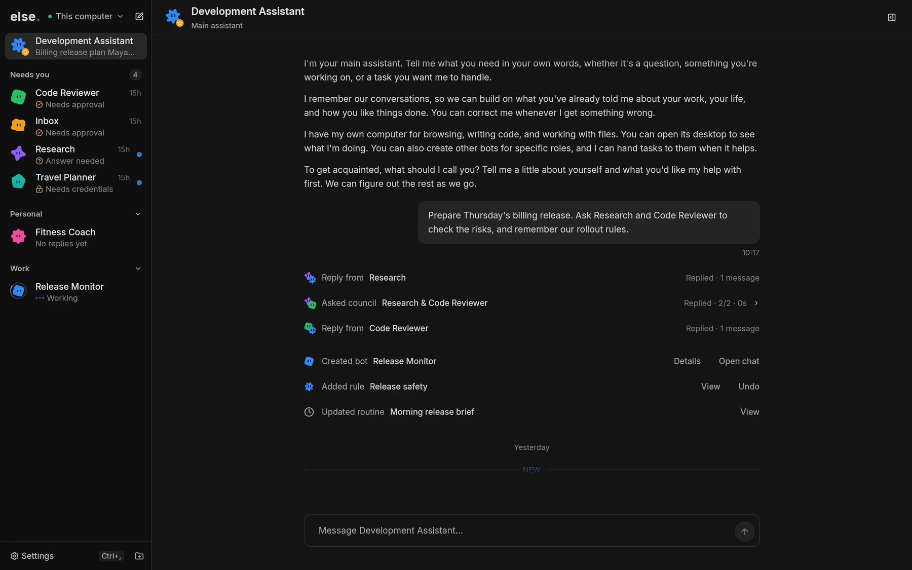
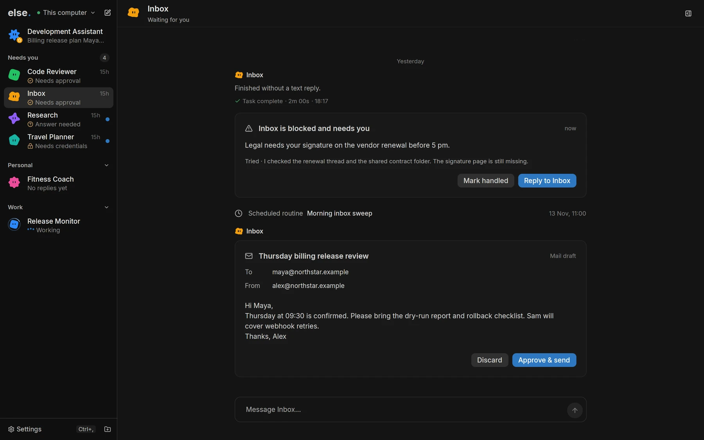
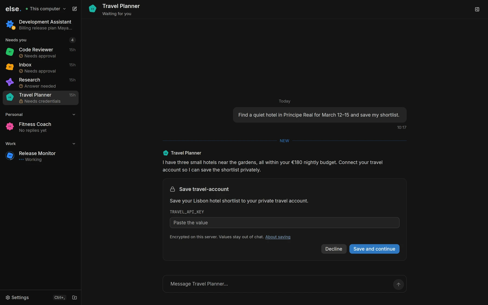
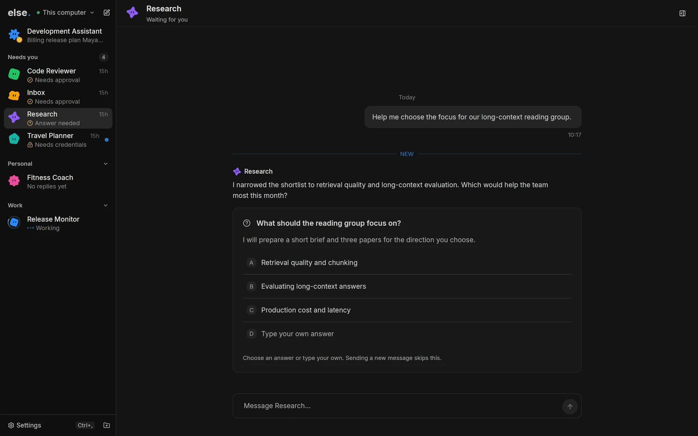
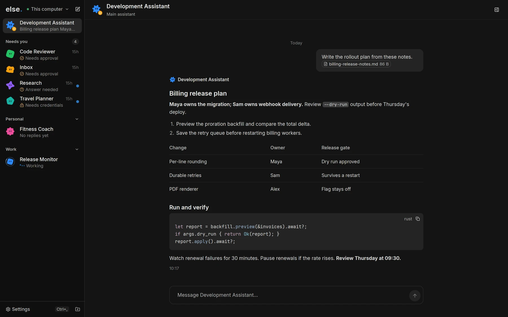

<p align="center">
  
</p>

<h1 align="center">else.bot</h1>

<p align="center">A team of AI bots that runs on your own machine.</p>

<p align="center">
  <a href="#install"><strong>Install</strong></a> ·
  <a href="docs/README.md">Docs</a> ·
  <a href="https://github.com/else-bot/else/releases">Releases</a>
</p>

<p align="center">
  
</p>

else.bot is a desktop app for chatting with AI bots. Each bot has its own job, model, memory and computer. They work in the background, hand tasks to each other, and ask you before they send anything in your name.

Bots run on the Codex, Claude Code or Grok Build CLI you already use, with your own subscription. The server and your data stay on your laptop, a home server or a VPS.

## What you get

- **A bot for each job.** Make a bot for code review, your inbox or trip planning. Pick a provider and model for each one, and switch any time.
- **A computer for every bot.** Each bot gets an isolated VM with a browser and a terminal. Open it to watch, or take over when the bot asks for help.
- **Bots that work together.** A bot can create other bots, delegate a task, or ask several bots and compare their answers.
- **You stay in control.** Emails, messages and risky actions wait for your approval. Passwords go in a private field, never in the chat.
- **Work on a schedule.** Bots set their own routines, reminders and webhook triggers.
- **Connected.** Gmail, Microsoft 365, Telegram, Discord, any MCP server, and skills from GitHub.
- **Your data at home.** Conversations and memory live in `~/.else`, with an encrypted backup every day.
- **Native and remote.** A Rust app for Linux and macOS. Run the server on another machine and connect over Tailscale.

<table>
  <tr>
    <td width="50%"><p align="center">Approve emails before they go out</p></td>
    <td width="50%"><p align="center">Hand over passwords privately</p></td>
  </tr>
  <tr>
    <td width="50%"><p align="center">Answer questions in one click</p></td>
    <td width="50%"><p align="center">Read rich answers with tables and code</p></td>
  </tr>
</table>

## Install

On Linux (Debian 12+, Ubuntu 24.04+, Arch, Omarchy) or macOS on Apple silicon, run as your normal user:

```sh
curl -fsSL https://raw.githubusercontent.com/else-bot/else/main/install.sh | bash
```

Then sign in to at least one provider CLI on the same machine:

```sh
codex login     # Codex CLI
claude          # Claude Code
grok login      # Grok Build
```

Open else.bot from your launcher, choose **Start local**, and name your assistant.

The installer can also set up only the server, for a VPS, or only the app, to connect to a server elsewhere. See [Install](docs/install.md) for every option.

## Docs

- [Getting started](docs/getting-started.md)
- [Email](docs/email.md)
- [Telegram and Discord](docs/telegram-discord.md)
- [Remote access](docs/remote-access.md)
- [Manage the server](docs/server.md)

## Contributing

See [CONTRIBUTING.md](CONTRIBUTING.md) to build from source, run a development session, and run the tests.

## License

[MIT](LICENSE). The shared agent skills in `.agents/` keep their upstream copyright notices in [.agents/NOTICE](.agents/NOTICE).
