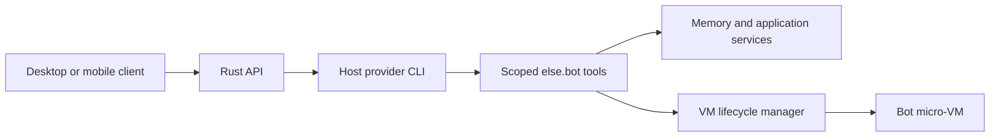

# Application architecture

These are the current application choices. The repository contains the API and desktop crates and development infrastructure. Implementation follows the [POC backlog](../TODO.md).

The project should use a monorepo. Start with the Rust API and GPUI desktop client for one owner. Add the mobile app later.

## Repository boundaries

| Location | Responsibility |
| --- | --- |
| `Cargo.toml` and `Cargo.lock` | Workspace membership, dependency resolution, and the shared application lockfile. |
| `apps/api` | Rust API executable and future server application behavior. |
| `apps/desktop` | Rust desktop executable and future GPUI interface. |
| `infra/compose.yaml` | Local PostgreSQL and future supporting container services. |
| `docs` | Product decisions, research, and development instructions. |
| `docs/experiments` | Independent verification fixtures, outside the application workspace. |

The desktop uses GPUI through the exactly pinned `gpui-kit` with a private Tokio runtime for HTTP. The API uses Tokio and Axum. Its `main.rs` only parses the command and composes the process; configuration and HTTP transport live in separate modules. Frameworks, GPUI, database dependencies, and internal modules are added with the features that need them. The [development guide](development.md) covers the current commands.

The desktop connects to the API through its public contract. It must not depend on the API executable or connect directly to PostgreSQL. Infrastructure configuration starts supporting services; the Rust programs run on the host.

Within the future API, application rules own their data types and required interfaces. HTTP handlers call application operations. PostgreSQL, provider CLI, and VM adapters implement those interfaces. Application rules must not depend on transport or storage frameworks. Add shared library crates only when concrete code needs a shared boundary.

## API

The API is the main entry point for clients and external tools. It should run on a server or dedicated hardware at home and expose an API and MCP access so other tools can connect.

The API should be written in Rust.

## Host and bot computers

The host is the personal computer, home server, or VPS running else.bot. It provides the installed `codex` and `claude` CLIs and manages provider authentication. The Rust API runs those CLIs through provider adapters on the host.

Each bot's micro-VM is a task environment with a terminal, files, Chromium, and a desktop. Provider CLIs and subscription credentials stay on the host. The VM executes requested work and returns results through tools controlled by the Rust API.

Skills explain how the agent uses these tools. The API enforces bot identity, permissions, VM leases, and resource limits. A conversation or connector task can run while the VM is stopped. Only work that uses the bot computer requires a VM lease.

Host CLI processes need restricted execution environments separate from the trusted API's secrets. The [host execution requirements](security.md#host-provider-processes) and [host-to-vm tool contract](providers.md#host-to-vm-tools-and-skills) still need validation with both CLIs.

## Desktop client

The desktop client should use Rust and GPUI and connect to the API.

The first desktop client should show a bot list, the selected conversation, and controls to create or delete a bot. Its main view should feel like a messaging app.

Use ordinary authenticated HTTP requests and one SSE stream for the selected bot. PostgreSQL owns conversation snapshots and replay cursors. The desktop deduplicates messages by stable IDs and keeps an unsent draft per bot. Opening another conversation or closing the window does not cancel server work.

The [desktop contracts](research/desktop-and-feature-contracts.md) define the proposed screens, endpoints, stream events, cancellation, and soft deletion. Twelve synthetic contract cases pass. A live GPUI build and real transport remain implementation checks. Rich markdown, attachments, account screens, and remote desktop tabs are outside the first slice.

Later, tabs across the top, like a browser, should let me open email, kanban, notes, and conversations.

## Mobile app

The current preference is to build native mobile apps, starting with iOS. The technology decision and mobile research are deferred until later.

Push notifications for new bot messages remain a requirement.

## Service responsibilities

The Rust API owns application state and client access. PostgreSQL stores that state, while bot computers retain their files in isolated environments. The clients connect to the API.

Start with one API instance and one scheduler. PostgreSQL rows provide durable queues and recovery. Provider adapters, memory compaction, VM lifecycle, and the backup worker run within that service. No Redis, message broker, distributed scheduler, or identity service is needed initially.

The detailed responsibilities are recorded in [provider integration](providers.md), [memory and storage](memory.md), [sandbox lifecycle](sandboxes.md), and [backup design](backups.md). [Startup requirements](restore.md#startup-must-preserve-existing-state) cover preservation of existing data and settings.
