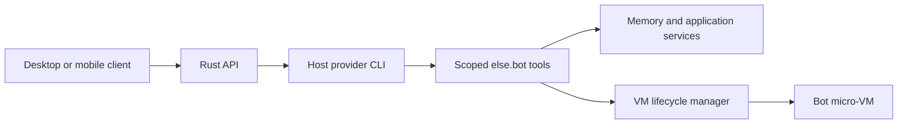

# Application architecture

These are the current application choices. The first usable POC is implemented: the API (Axum, one in-process scheduler, SQLite, host Codex and Claude adapters) and the GPUI desktop. Implementation follows the [POC backlog](../TODO.md).

The project should use a monorepo. Start with the Rust API and GPUI desktop client for one owner. Add the mobile app later.

## Repository boundaries

| Location | Responsibility |
| --- | --- |
| `Cargo.toml` and `Cargo.lock` | Workspace membership, dependency resolution, and the shared application lockfile. |
| `apps/api` | Rust API executable and future server application behavior. |
| `apps/desktop` | Rust desktop executable and future GPUI interface. |
| `infra/compose.yaml` | Optional S3 emulator for replication tests. SQLite runs inside the API. |
| `docs` | Product decisions, research, and development instructions. |
| `docs/experiments` | Independent verification fixtures, outside the application workspace. |

The desktop uses GPUI through the exactly pinned `gpui-kit` with a private Tokio runtime for HTTP. The API uses Tokio and Axum. Its `main.rs` only parses the command and composes the process; configuration and HTTP transport live in separate modules. Frameworks, GPUI, database dependencies, and internal modules are added with the features that need them. The [development guide](development.md) covers the current commands.

The desktop connects to the API through its public contract. It must not depend on the API executable or connect directly to SQLite. Infrastructure configuration starts supporting services; the Rust programs run on the host.

Within the API, `app` owns validated values and provider/tool contracts. `http` translates requests and errors, `db` owns transactional writes, and the scheduler coordinates provider attempts. Provider adapters depend on application contracts, including `app/tools.rs`, rather than HTTP handlers. The VM subsystem owns its runtime interface and lifecycle. Shared library crates are unnecessary until another executable needs the same Rust contract.

### Ownership within the applications

| Module | Owns |
| --- | --- |
| `db/turns.rs` | Message acceptance, queue claims, attempt inputs, and restart recovery. |
| `db/turn_sink.rs` | One attempt's fenced writes and bounded text buffer, owned by its actor. |
| `computers/mod.rs` | Runtime admission, startup/wake transitions, resource budgets, and per-bot operation coordination. |
| `computers/leases.rs` | Lease creation, renewal, release, and validation before execution. |
| `computers/maintenance.rs` | Owner stops, reconciliation, idle policy, and maintenance loops. |
| `computers/desktop.rs` and `snapshot.rs` | Desktop access and service startup; stopped-disk backup capture. |
| `computers/jobs.rs` | Durable background-job admission, inspection, cancellation, and completion. |
| `computers/jobs/commands.rs` and `files.rs` | Foreground execution/interruption; guest files and artifact transfer. |
| `providers/claude/protocol.rs` | Claude event decoding and verification of terminal outcomes. |
| `providers/codex/summary.rs` | Ephemeral sessions that enforce a no-tool policy for summaries and checkpoints. |
| `providers/prompt.rs` | Shared instructions and context packets, including checkpoint instructions used by both adapters. |
| Desktop `app.rs` | Connection state, selection, drafts, pending sends, and composition of the window. |
| Desktop `app/categories.rs`, `dialogs.rs`, `conversation.rs`, and `view.rs` | Category flows, bot/onboarding forms, committed transcript updates, and rendering. Form details stay private to their module. |
| Desktop `api.rs` and `api/live.rs` | REST commands and typed requests; bounded WebSocket delivery and reconnection. |

State actors have bounded mailboxes. Runtime operations serialize per bot, so one bot's operation does not hold another bot's runtime lock. SQLite immediate transactions arbitrate database writers; readers use WAL connections. There is no application-level global lock around unrelated runtime operations, and no advisory-lock wrapper pretending to provide coordination. Independent async operations run together; transactions and runtime transitions retain their required order.

Bot creation is one transaction containing the bot, owner conversation, optional profile and category, receipt, and notification. Its receipt hashes the full creation input. The desktop retains that complete typed request while its outcome is unknown. A matching retry reads current state and never reapplies old profile or category choices. Plain create receipts from earlier versions remain compatible; old receipts created with a profile cannot prove that original profile and safely conflict with a profiled retry.

### Foundation review

The November 2026 review found and fixed these issues in separate commits:

| Finding | Fix commit |
| --- | --- |
| Creation could commit without its profile; retries could overwrite later settings; category assignment required another request. | `56b5c4c` makes creation atomic and retries immutable. |
| Provider adapters depended on HTTP's tool inventory. | `fee7228` gives the application layer ownership of the shared contract. |
| Queue operations and actor-owned provider writes shared one large file; the old request-lock API did nothing. | `08cb6ed` separates the SQLite sink, removes its redundant buffer wrapper, and deletes the no-op lock API. |
| Input counter cleanup reset active turns' allowances. | `e329183` retires settled counters while retaining live allowances. |
| VM lifecycle, desktop access, backup capture, commands, and file transfer accumulated in two oversized modules. | `640f56b` separates those responsibilities while preserving their operation guards. |
| Provider process orchestration mixed with event policy and no-tool execution; Claude's shared checkpoint instructions lived in Codex. | `35cd2c0` separates policies and moves shared instructions to the prompt module. |
| The desktop window mixed form state, network effects, transcript reconciliation, and rendering. | `ad723db` gives those concerns separate modules and isolates socket handling. |

Regression coverage includes a forced profile-write failure, matching and changed creation retries, later profile/category edits, and input-counter cleanup while a turn remains active. Existing suites cover cancellation, restart recovery, concurrent category changes, bounded actors, provider event policy, handoffs, backups, and WebSocket replay. Validation passed formatting, locked workspace compilation, and every compiled workspace test suite. Tests ran inside an isolated omabox session, with the dependency source assets mounted for debug-build localization. Live opt-in flags were unset; no new manual GPUI walkthrough was performed.

This remains a single-owner, single-API-process application, enforced by its runtime lock. Live provider authentication, Microsandbox behavior, and S3 interoperability retain their opt-in acceptance checks; mocked runtime and protocol tests do not replace those checks.

## API

The API is the main entry point for clients and external tools. It should run on a server or dedicated hardware at home and expose an API and MCP access so other tools can connect.

The API should be written in Rust.

## Host and bot computers

The host is the personal computer, home server, or VPS running else.bot. It provides the installed `codex` and `claude` CLIs and manages provider authentication. The Rust API runs those CLIs through provider adapters on the host.

Each bot's micro-VM is a task environment with a terminal, files, Chromium, and a desktop. Provider CLIs and subscription credentials stay on the host. The VM executes requested work and returns results through tools controlled by the Rust API.

Each bot also has a project directory on the host, `<ELSE_BOTS_DIR>/<bot id>`. Its provider CLI starts there, with its own shell and file tools and the owner's access, and the bot's VM mounts the same directory at `~/work`. Bots work in their VM by default and on the host when the owner asks. See the [decision record](decisions/0001-providers-run-on-the-host.md) and [host provider processes](security.md#host-provider-processes).

Skills explain how the agent uses these tools. The API enforces bot identity, permissions, VM leases, and resource limits. A conversation or connector task can run while the VM is stopped. Only work that uses the bot computer requires a VM lease.

Host CLI processes need restricted execution environments separate from the trusted API's secrets. The [host execution requirements](security.md#host-provider-processes) and [host-to-vm tool contract](providers.md#host-to-vm-tools-and-skills) still need validation with both CLIs.

## Desktop client

The desktop client should use Rust and GPUI and connect to the API.

The first desktop client should show a bot list, the selected conversation, and controls to create or delete a bot. Its main view should feel like a messaging app.

Use ordinary authenticated HTTP requests for commands and one owner WebSocket for live updates, with pub/sub channels for the bot list and each open conversation. An SSE stream plus sidebar polling was tried first and replaced; the [contract](research/desktop-and-feature-contracts.md#history-sse-and-polling-were-tried-first) records why. SQLite owns conversation snapshots and replay cursors. The desktop deduplicates messages by stable IDs and keeps an unsent draft per bot. Opening another conversation or closing the window does not cancel server work.

The [desktop contracts](research/desktop-and-feature-contracts.md) describe screens, endpoints, stream events, cancellation, and soft deletion. The implemented GPUI client uses the real HTTP and WebSocket transports, with automated client/model tests and the live scenarios recorded in the [acceptance record](implementation/acceptance.md). Rich markdown, attachments, account screens, and remote desktop tabs are outside the first slice.

Later, tabs across the top, like a browser, should let me open email, kanban, notes, and conversations.

## Mobile app

The current preference is to build native mobile apps, starting with iOS. The technology decision and mobile research are deferred until later.

Push notifications for new bot messages remain a requirement.

## Service responsibilities

The Rust API owns application state and client access. SQLite stores that state, while bot computers retain their files in isolated environments. The clients connect to the API.

Start with one API instance and one scheduler. SQLite rows provide durable queues and recovery. Provider adapters, memory compaction, VM lifecycle, and the backup worker run within that service. No Redis, message broker, distributed scheduler, or identity service is needed initially.

Mutable runtime registries belong to actors with bounded mailboxes (64 operations per actor). Callers await capacity, and an accepted operation finishes even if its caller is cancelled. Turn persistence has one actor per turn, WebSocket subscriptions one per connection, and foreground command retirement one per command. The provider RPC actor owns its stdin and response registry, caps in-flight requests at 64, and reclaims cancelled requests. Computer operations take a single permit per bot, so unrelated bots proceed independently; unused permit entries are reclaimed. Maintenance admission, authentication budgets, and fault counters use atomics. Provider turns and memory summaries share bounded semaphore capacity.

The desktop sends subscription snapshots through a capacity-one mailbox: changes during a disconnect coalesce to the latest desired subscriptions, retaining delivered replay cursors. Its lossless event queue holds 256 entries and waits for the UI to consume them. Provider output and WebSocket output are also bounded; a provider that overruns its output queue is disconnected.

The detailed responsibilities are recorded in [provider integration](providers.md), [memory and storage](memory.md), [sandbox lifecycle](sandboxes.md), and [backup design](backups.md). [Startup requirements](restore.md#startup-must-preserve-existing-state) cover preservation of existing data and settings.
