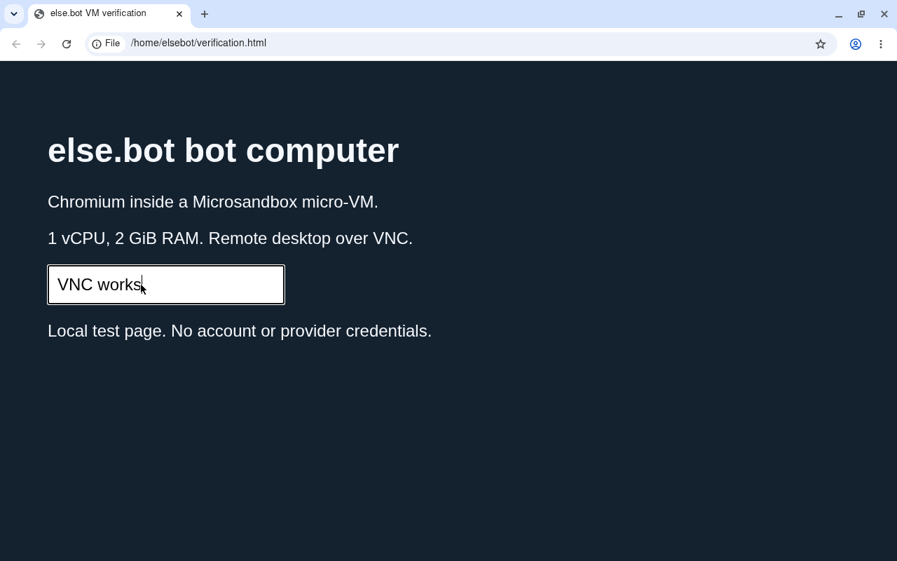

# Bot VM verification

VERIFIED for the tested local prototype. Keep Microsandbox v0.7.13 for the first else.bot implementation. It met the measured lifecycle, desktop, snapshot, and Rust integration requirements on this Linux host. This is a recommendation for the prototype, not a completed security review or whole-assistant recovery test.

The [initial October 25 attempt](vm-snapshots.md#october-25-preflight-attempt) stopped before VM creation. On November 2, 2026, the host exposed AMD `svm` and KVM API 12. The restricted tool sandbox still hid `/dev/kvm`, so VM tests ran on the host. The runtime's diagnostics passed without changing host KVM settings.

## Test environment

The host used AMD Ryzen 5 5600X 6-Core Processor with 12 logical CPUs. Each test guest had 1 vCPU, 2 GiB RAM, and a 4 GiB root disk. The guest kernel was 6.12.113. The image was `python:3.12-slim`, pinned in the result record by manifest digest.

The [official v0.7.13 release](https://github.com/superradcompany/microsandbox/releases/tag/v0.7.13) was published on November 1. Its Linux bundle matched the published SHA-256 digest. Tests used private home, cache, and runtime directories with no existing credentials. No Docker daemon, vendor login, or separate sandbox management service was used. The project still labels itself [beta software](https://github.com/superradcompany/microsandbox).

## What passed

| Requirement | Observed result |
| --- | --- |
| Separate bot computers | Two named guests retained different values at the same filesystem path. Neither saw a synthetic host file. Each reported one CPU and its guest kernel. |
| Stop and restart | A saved file survived stop and start. Stop removed the VM worker; a new worker started in 0.186 seconds. |
| Pause and resume | The same guest process and RAM nonce survived a two-second pause. Its counter advanced once across the pause. |
| Detached operation | CLI-created guests remained available after the creating process exited and across the interrupted measurement turn. |
| Native Rust control | SDK create, exec, stop, and reconnect passed. Reconnecting preserved the saved file and the existing 1 vCPU, 2 GiB settings despite different builder defaults. |
| Desktop | Chromium, Xvfb, Openbox, and a terminal ran as an unprivileged guest user. Chromium started without `--no-sandbox`. |
| Remote access | VNC delivered a 1280 by 800 desktop and keyboard input reached Chromium. noVNC returned HTTP 200 and accepted a WebSocket upgrade. Test ports bound only to host loopback. |
| Disk recovery | An archive with its image included restored into an empty runtime. The saved file survived. |
| Full recovery | A guest daemon and its RAM nonce resumed from the exported random-data archive after the original runtime was removed. The baseline disk archive supplied the required OCI image. |
| Desktop recovery | A disk archive restored the installed desktop and browser profile. The profile's `Local State` file hash matched before browser startup, and Chromium and VNC worked after restoration. |

The first create took 3.997 seconds with an image pull. A second create using the cached image took 0.226 seconds. These are single observations, not startup averages or measurements of the complete desktop launch.



## Resource behavior

The empty Python guest used about 141 MiB of host VM-worker RSS. The running test service used 189.7 MiB, and the paused service retained 189.8 MiB. Stop removed the worker process.

The restored desktop with one local Chromium page used about 563 MiB of worker RSS. The first desktop run retained about 1.49 GiB after package installation, including guest caches. Keep 2 GiB per active desktop bot as a prototype budget. Real websites, more tabs, and provider CLIs still need workload measurements.

Use stop when the idle policy needs to reclaim RAM. Pause preserves execution for short idle periods but still counts against the memory budget.

## Snapshot sizes

These `.msb` archives used the default zstd compression and excluded OCI image artifacts. They were not encrypted or uploaded. The workloads intentionally vary compressibility; allocated guest RAM does not predict a fixed compressed size.

| Synthetic workload | Disk archive | Full archive |
| --- | ---: | ---: |
| Idle guest with a 16 MiB test buffer | 0.78 MiB | 24.19 MiB |
| 512 MiB repeated RAM and 128 MiB repeated disk data | 0.89 MiB | 29.34 MiB |
| 512 MiB random RAM and 128 MiB random disk data | 128.94 MiB | 805.51 MiB |

An idle disk archive with the Python image included was 37.47 MiB. The installed desktop and browser-profile disk archive, also including the image, was 658.62 MiB. Desktop archive import and VM boot took 3.22 seconds. Starting the restored display stack and browser then took 1.47 seconds.

## Snapshot and recovery constraints

Full capture rejected an active managed `exec --detach` job with the message `full capture and fork are unavailable while managed jobs are active`. After launching the same test service as an ordinary guest daemon and ending the managed session, full capture and restoration passed. Disk capture worked with guest services still running.

Use disk archives for routine backups. Drain managed jobs before an optional full checkpoint. A full snapshot must not be presented as a way to freeze an arbitrary active Codex or Claude execution session. External connections still need reconnection after restoration.

The first desktop fixture captured Chromium while it was still open. Restoration under a different VM hostname carried its profile lock and prevented startup. The corrected fixture closed Chromium through its control API, verified that the browser process and profile lock were gone, then captured the disk. The `Local State` file hash matched after restore and the browser opened normally. Other profile files were not individually hashed. The backup worker needs an application checkpoint before the guest filesystem flush.

## Remaining integration work

- Build a repeatable desktop image and launch its services through a supervised guest startup process.
- Test Codex and Claude subscription login, renewal, MCP access, and conversation recovery in the guest.
- Implement and test else.bot's VM leases, idle policy, resource queue, and handling of owner-stopped bots.
- Test PostgreSQL and VM backup coordination, encrypted R2 or S3 uploads, retention, and whole-assistant restore.
- Validate network and tool permissions against hostile workloads. The filesystem canary and browser checks are smoke tests, not a VM escape or prompt injection audit.

All disposable VMs were stopped and removed. Raw VM state and build caches were reclaimed. Compressed archives, command logs, and temporary fixtures remain under `/tmp/elsebot-vm-verification.txbvjsdy`.

## Reproduction

The [snapshot guide](run-vm-snapshot-benchmark.md) runs isolated synthetic captures with a guest daemon. The [machine-readable results](results/microsandbox-v0.7.13-linux.json) record sizes, checksums, timing, and the runtime and image versions. The guide's worker and the test service in this report are different fixtures, so their byte counts need not match.

The exact guide script also passed an idle run on November 2. It produced both archives and removed its VM successfully.

## Rust SDK check

The temporary crate used Cargo defaults disabled, `local` and `net` enabled, and matching runtime and firmware paths. It ran with Rust 1.98.0. These are verification fixtures, not application implementation.

<details>
<summary>Temporary Rust crate</summary>

```toml
[package]
name = "elsebot-vm-sdk-smoke"
version = "0.0.0"
edition = "2024"

[dependencies]
microsandbox = { version = "=0.7.13", default-features = false, features = ["local", "net"] }
tokio = { version = "1", features = ["macros", "rt-multi-thread"] }

[profile.dev]
debug = 0
incremental = false
```

```rust
use microsandbox::Sandbox;

#[tokio::main]
async fn main() -> Result<(), Box<dyn std::error::Error>> {
	let sandbox = Sandbox::builder("elsebot-fit-txbvjsdy-rust")
		.image("python:3.12-slim")
		.cpus(1)
		.memory(2048)
		.create()
		.await?;
	let output = sandbox
		.exec("python3", ["-c", "from pathlib import Path; Path('/root/rust-sdk-marker').write_text('saved'); print('RUST_SDK_OK')"])
		.await?;
	assert_eq!(output.stdout()?.trim(), "RUST_SDK_OK");
	sandbox.stop().await?;
	drop(sandbox);
	let existing = Sandbox::builder("elsebot-fit-txbvjsdy-rust")
		.image("python:3.12-slim")
		.cpus(2)
		.memory(512)
		.connect_or_create()
		.await?;
	let resumed = existing
		.exec("python3", ["-c", "from pathlib import Path; import os; print(Path('/root/rust-sdk-marker').read_text() + ':' + str(os.cpu_count()))"])
		.await?;
	assert_eq!(resumed.stdout()?.trim(), "saved:1");
	existing.stop().await?;
	println!("Rust SDK create, exec, stop, connect_or_create, and existing configuration preservation passed");
	Ok(())
}
```

</details>
