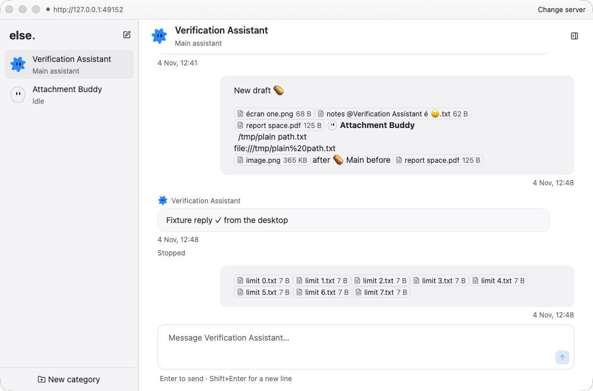
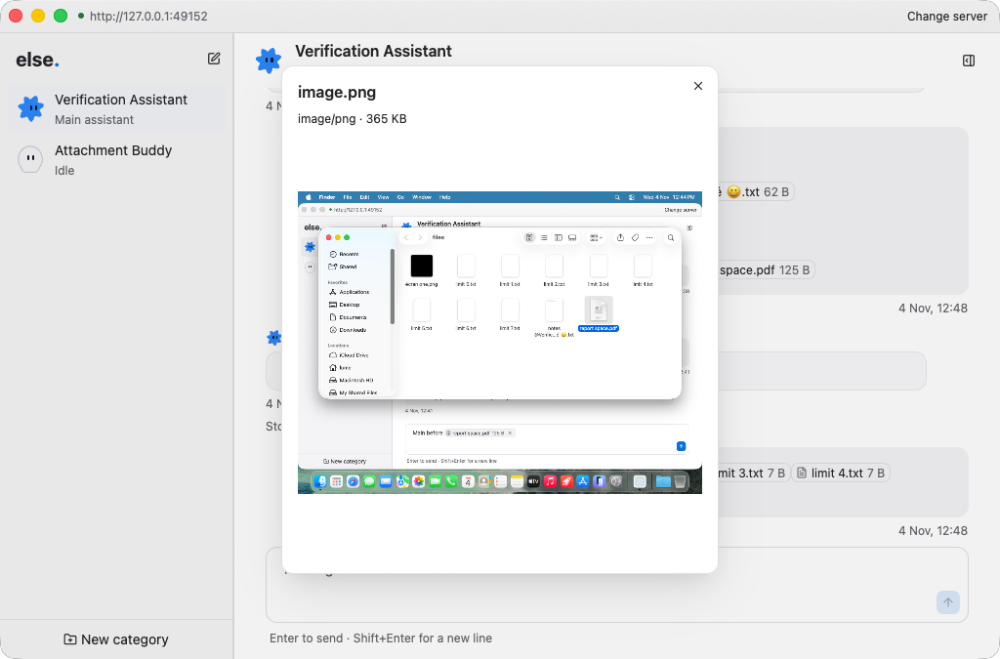

# Native macOS arm64 verification

PR 60 keeps pasted files at their position in a message. Its supported offline native attachment behavior is **VERIFIED** at `2efcf4ef1b1c83527843a08328094053cd9d1958`.

No application defect reproduced, so this takeover adds evidence and verification notes only. The test code revision remains the fetched PR head. The later documentation commit does not change either binary.

## Environment and evidence

The host is Darwin 25.6 on arm64. Rust 1.99.1 reports `aarch64-apple-darwin`. Both built binaries are Mach-O arm64 executables. The owned Lume guest runs Darwin 25.5 on arm64. Its copied binary hashes match the host payload. The restarted app's hash also matches that payload. No Rosetta or architecture emulation was used.

Lume 0.6.1 cloned the stopped base `ghcr.io/trycua/macos:26-20261021-fca2193`, with digest `sha256:7cb23670cad48a6723cf667bc63c444b83dc0c73756c23b614897127d5ba22ba`. Input and screenshots used the guest MCP endpoint. The guest had a disposable API, HOME, profile, SQLite database, and offline Codex fixture.

The durable private evidence directory is `/Users/iam4x/.local/share/else-verify/evidence/pr60-2efcf4e-macos-20261105`. It contains commands, build and test logs, architecture records, action JSON, AX trees, screenshots, API records, source fixtures, downloaded bytes, and a SQLite snapshot. The run manifest records payload hashes and cleanup. The original working evidence is under `.else-dev/pr60-macos-evidence`.

Run the artifact checker against either directory:

```sh
python3 docs/verification/inline-attachments/check-macos-evidence.py /absolute/evidence/directory
```

The checker validates stored evidence. Native input and layout additionally require reviewing the captured screenshots and action records.

## Results

| Check | Observed result |
| --- | --- |
| Screenshot Cmd+V at start, middle, and end | Three inline chips retained exact surrounding spaces, Unicode, and emoji. |
| Finder copies | Image, UTF-8 text, and PDF files pasted individually and together. Names included spaces, Unicode, emoji, and bot names. Finder file-reference order matched the saved parts. |
| Eight-file limit | Eight files pasted. Another eight were refused. Selecting the existing draft allowed replacement with eight files. |
| Plain copied paths | Nonexistent paths remained text. A second owned native run copied an existing Unicode filename with Finder Copy as Pathname, then pasted its bare pathname and `file://` text. The saved clipboard text matched exactly, with zero file parts and zero uploads. |
| X, Backspace, undo, and redo | Chips disappeared and returned with the surrounding text. The original three attachment IDs survived through the saved message and cold reload. |
| Upload and retry | A guest-local proxy held the upload, returned 503, and then allowed Retry upload. Both requests used the same file ID and metadata. Typing and switching drafts preserved the chip's position. |
| Rejected send | A 429 rejection restored five files into a new draft. The accepted message retained their IDs, order, and exact original text after the new draft prefix. |
| Bot drafts | Main and child drafts retained their own files and text across native sidebar switches. |
| Previews | Image and text previews opened in drafts and sent messages, including after restarting both processes. The ASCII PDF fixture displayed its raw source as text. The binary PDF showed the unsupported-preview fallback. PDF page rendering is unavailable. |
| Mentions and files | Sent bot avatars and file chips shared the row without overlap. A filename containing a bot name stayed one file chip. Clicking the mention did not open a file preview. Clicking the file opened the correct file. |
| Persistence and bytes | Five expected messages with 20 file references matched before and after cold restart. API parts, SQLite parts, expected text, whitespace, IDs, source-file bytes, stored hashes, and downloaded bytes agreed. |





## Tests and limitations

`python3 .agents/skills/verify-else/verify.py --full --backend process --output .else-dev/pr60-macos-evidence/workspace` built both binaries and ran 33 Rust executables. All 515 Rust tests passed, including 135 desktop tests, 130 API unit tests, and all four attachment integration tests. The doctest command found zero doctests. Formatting and diff checks passed. The runner's nine failure-path tests passed.

The full runner's aggregate status is **failed**. Its unrelated `bots` HTTP journey sends the removed `role` field to `PATCH /v1/bots/{id}` and receives 400. Its messaging, categories, and onboarding journeys passed. The application changes in this PR do not introduce that obsolete request. The verifier was left unchanged.

Native automation needed two corrections. Finder and sidebar background pixel actions reported delivery without selecting their targets, so guest foreground input was used after inspecting the results. A manually restarted API initially omitted the guest Python directory from PATH. The fixture then failed to launch and two sends were rejected. After correcting PATH, both drafts were restored, sent, and checked in storage. Those earlier sends are not counted as successful sends.

Live Codex image and text inference is **NOT TESTED**. The disposable environment contained only the offline fixture and an empty fixture auth file. Live Claude image and text inference is **NOT TESTED**. Its executable and authenticated configuration were absent. Host provider credentials were not imported. Offline streaming and protocol tests do not prove live inference.

The runner excludes live integration targets and replication. Real provider subscriptions, S3 replication, real bot computers, and installer updates were outside this attachment verification. Existing Linux results remain separate evidence.

Cleanup exported guest evidence, stopped the additional API, desktop, and fault proxy, and deleted only the two owned clones. Fresh Lume metadata confirmed its absence and confirmed that the base remained stopped with its original identity.

The byte checker compares 16 file references with exported source fixtures. Four screenshot references have no separate source fixture and are checked against stored bytes and hashes. Provider environment variables were omitted from the durable copy to avoid exporting credentials. A redacted environment record and the guest assertion command record the fixture-only configuration. Finder order is a recorded in-guest assertion against file-reference inodes. The original inode table was not exported, so the offline checker cannot reconstruct that mapping.

The independent review used Claude Fable 5.1 with high effort. Its verdict supports the native result. Its checker findings were fixed by keeping checks active under Python optimization, requiring all 16 source-file comparisons, checking the tested revision and original upload IDs, and testing corrupted evidence. Its PDF and doctest wording findings are reflected above.
